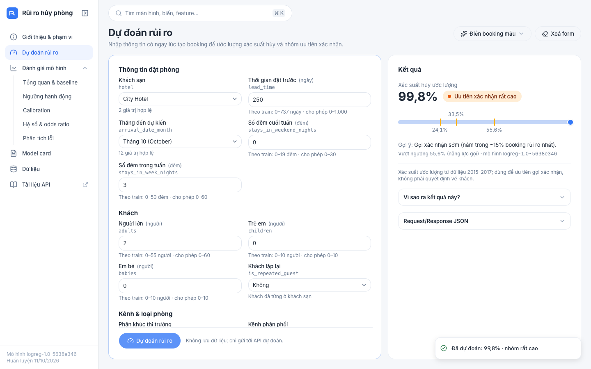
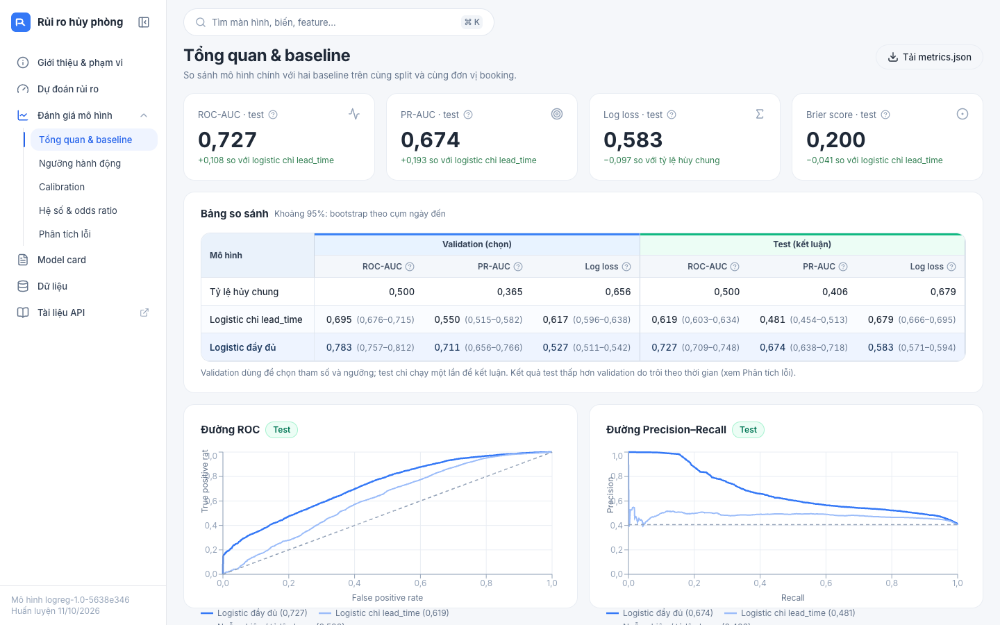
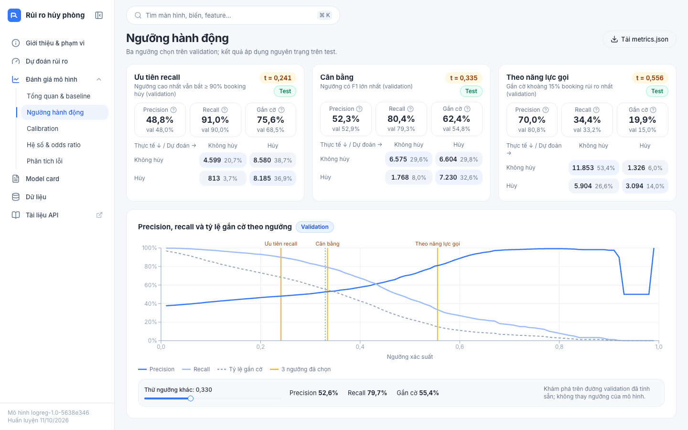

# Dự đoán khả năng hủy đặt phòng tại thời điểm đặt

**Project 13** · Học phần Học máy cơ bản · Bài 5: Hồi quy logistic, phân loại bằng xác suất · Lớp 12523W.1 ·
GV PGS.TS. Nguyễn Văn Hậu

Với thông tin có **ngay lúc booking được tạo**, mô hình **hồi quy logistic** ước lượng xác suất booking bị hủy và xếp
booking vào nhóm ưu tiên gọi xác nhận theo ba ngưỡng hành động. Kèm theo là một ứng dụng web (FastAPI + React) để
nhập booking, xem kết quả, đánh giá mô hình và đọc model card.

> **Sử dụng có trách nhiệm:** mô hình chỉ dùng để **ưu tiên gọi xác nhận**. Không dùng để tự động hủy booking, tăng
> giá hay phân biệt đối xử với khách. Ứng dụng không lưu dữ liệu booking.



## Kết quả chính

Đánh giá trên tập test độc lập (22.177 booking đến 05–08/2017), chỉ chạy một lần sau khi đã chốt mô hình và ngưỡng:

| Mô hình | ROC-AUC (KTC 95%) | PR-AUC | Log loss | Brier |
|---|---|---|---|---|
| Baseline: tỷ lệ hủy chung | 0,500 | 0,406 | 0,679 | 0,243 |
| Baseline: logistic chỉ `lead_time` | 0,619 (0,603–0,634) | 0,481 | 0,680 | 0,242 |
| **Logistic đầy đủ (16 biến lúc đặt)** | **0,727 (0,709–0,748)** | **0,674** | **0,583** | **0,200** |

- Xác suất được hiệu chỉnh tốt: dự đoán trung bình 39,5% so với tỷ lệ hủy thực tế 40,6%.
- Ba ngưỡng chọn trên validation: 0,241 (bắt 91% booking hủy), 0,335 (cân bằng F1), 0,556 (gắn cờ khoảng 15–20%
  booking, precision 0,70).
- Trên validation (01–04/2017) ROC-AUC đạt 0,783; mức giảm ở test do trôi theo thời gian, được phân tích trong
  [báo cáo](reports/report/bao_cao_project13.pdf) và [model card](reports/model_card.md).

## Chạy nhanh

Yêu cầu Python 3.14 (đã kiểm thử 3.14.7). Không cần Node.js để chạy ứng dụng: giao diện đã được build sẵn.

```bash
git clone https://github.com/Nguyenvan01/hotel-booking-cancellation-prediction.git
cd hotel-booking-cancellation-prediction
python3.14 -m venv .venv
source .venv/bin/activate            # Windows: .venv\Scripts\activate
pip install -r requirements.txt

make app                             # chỉ chạy web với mô hình đã lưu -> http://localhost:8000
make all                             # hoặc tái lập toàn bộ: data → train → evaluate → test → app
```

| Bước | Lệnh (khi không có `make`) | Đầu ra |
|---|---|---|
| Tải + kiểm tra dữ liệu | `python -m src.data` | `data/raw/` (không commit), `reports/data_quality.md` |
| Huấn luyện | `python -m src.train` | `models/model.joblib`, `models/config.json`, `reports/experiments.csv` |
| Đánh giá test | `python -m src.evaluate` | `models/metrics.json`, `reports/results.md`, `reports/curves.json`, `reports/figures/` |
| Kiểm thử | `python -m pytest -q tests` | 51 test: leakage, tiền xử lý, API |
| Web + API | `python -m uvicorn app.main:app --port 8000` | http://localhost:8000, tài liệu API ở `/docs` |
| EDA (tùy chọn) | `make eda` | `notebooks/eda.ipynb` |

## Ứng dụng web

| Màn hình | Đường dẫn | Nội dung |
|---|---|---|
| Giới thiệu & phạm vi | `/` | Câu hỏi nghiên cứu, phạm vi dữ liệu, cách dùng có trách nhiệm, các biến đã loại (kèm lý do) |
| Dự đoán rủi ro | `/predict` | Form sinh từ `/api/model-info`, xác suất + nhóm ưu tiên, cảnh báo ngoài miền, JSON request/response, giải thích log-odds |
| Đánh giá mô hình | `/evaluation/overview` · `thresholds` · `calibration` · `odds` · `errors` | Baseline, ba ngưỡng và ma trận nhầm lẫn, reliability diagram, odds ratio, sai số theo nhóm và tháng |
| Model card | `/model-card` | Render nguyên văn `reports/model_card.md` |
| Dữ liệu | `/data` | Nguồn, giấy phép, checksum, chất lượng dữ liệu, data dictionary |

- Tìm kiếm toàn cục bằng `Ctrl/⌘ K`, không cần gõ dấu (màn hình, tên biến; nhảy tới đúng dòng trong bảng).
- `/predict?demo=high` (hoặc `low`, `medium`, `ood`) tự điền booking mẫu giả lập và gửi, dùng khi demo.
- Mọi số liệu và biểu đồ đọc từ file đã sinh; giao diện không chứa logic mô hình và không lưu dữ liệu nhập.

| Tổng quan & baseline | Ngưỡng hành động |
|---|---|
|  |  |

Giao diện: React + TypeScript (Vite, Tailwind CSS v4, shadcn/ui trên Base UI, TanStack Query/Table,
React Hook Form + Zod, Recharts, motion), mã nguồn trong `frontend/`. Để sửa giao diện (cần Node.js 20+):

```bash
cd frontend && npm ci
npm run dev        # http://localhost:5173, proxy /api tới uvicorn cổng 8000 (chạy make app song song)
make ui            # build lại vào app/web
```

## API

`POST /api/cancellation-risk`

```bash
curl -X POST http://localhost:8000/api/cancellation-risk -H "Content-Type: application/json" -d '{
  "hotel": "City Hotel", "lead_time": 120, "arrival_date_month": "August",
  "stays_in_weekend_nights": 1, "stays_in_week_nights": 2, "adults": 2, "children": 0, "babies": 0,
  "meal": "BB", "market_segment": "Online TA", "distribution_channel": "TA/TO", "reserved_room_type": "A",
  "customer_type": "Transient", "is_repeated_guest": false,
  "previous_cancellations": 0, "previous_bookings_not_canceled": 0}'
```

```json
{
  "probability": 0.5246,
  "risk_group": "Cao",
  "action": "Gửi nhắc/xác nhận chủ động khi còn năng lực",
  "threshold_used": 0.3345,
  "thresholds": {"high_recall": 0.2408, "balanced_f1": 0.3345, "capacity": 0.5555},
  "model_version": "logreg-1.0-5638e346",
  "warnings": []
}
```

| Tình huống | Mã | Ví dụ |
|---|---|---|
| Thiếu trường / body không phải JSON | 400 | `{"detail": [{"field": "hotel", "message": "Thiếu trường bắt buộc", "type": "missing"}]}` |
| Sai kiểu (ví dụ `"lead_time": "12"`), hạng mục không hợp lệ, ngoài miền, trường lạ, 0 khách | 422 | `{"detail": [{"field": "lead_time", "message": "Phải là số nguyên", "type": "int_type"}]}` |
| Lỗi nội bộ | 500 | `{"detail": "Lỗi nội bộ; không có dữ liệu nào được lưu. Vui lòng thử lại."}` |

Không giá trị nào bị tự điền hay tự ép kiểu. Đầu vào hợp lệ nhưng hiếm hoặc nằm ngoài miền train (ví dụ
`lead_time` > 737) vẫn được dự đoán, kèm cảnh báo trong `warnings`.

Các endpoint khác (chỉ đọc file đã lưu, không tính lại): `POST /api/explain` (đóng góp log-odds),
`GET /api/health`, `/api/model-info`, `/api/metrics`, `/api/model-card`, `/api/data-card`,
`/api/files/{metrics.json|data_dictionary.csv|model_card.md}`.

## Kiểm thử

```bash
make test                                   # 51 test: leakage, tiền xử lý, API
cd frontend && npm ci && npm run e2e        # 17 kịch bản end-to-end trên Chrome (cần make app đang chạy;
                                            # đặt CHROME_PATH nếu Chrome không ở vị trí mặc định của macOS)
```

## Tái lập và chống rò rỉ

- Dữ liệu tải bằng script, kiểm tra SHA-256 của zip và từng CSV, số dòng (119.390), tên và kiểu cột.
- Chia theo **ngày đến** trước mọi bước học (train 07/2015–12/2016, validation 01–04/2017, test 05–08/2017); mọi
  encoder/scaler nằm trong `Pipeline` và chỉ fit trên train.
- Loại 5 biến chỉ biết sau lúc đặt (theo đề bài) và 7 biến nghi ghi nhận sau lúc đặt hoặc có rủi ro công bằng (chỗ
  đậu xe, loại tiền cọc, giá/đêm, yêu cầu đặc biệt, quốc tịch, mã đại lý/công ty); lý do từng biến trong
  [docs/decisions.md](docs/decisions.md). `tests/test_leakage.py` kiểm tra tự động.
- Mô hình, tham số, `class_weight` và ba ngưỡng chọn **chỉ trên validation**; mỗi lần chạy test được ghi vào
  `reports/test_runs.log`. Huấn luyện lại trên máy sạch cho ra mô hình trùng từng byte (cùng SHA-256).
- `seed: 42` và mọi tham số ở `config.yaml`; phiên bản thư viện pin trong `requirements.txt`.

## Tài liệu

| Tài liệu | Đường dẫn |
|---|---|
| Báo cáo (PDF, DOCX) | [reports/report/](reports/report/) |
| Slide và kịch bản demo | [reports/slides/README.md](reports/slides/README.md) |
| Model card | [reports/model_card.md](reports/model_card.md) |
| Đặc tả bài toán | [docs/project_brief.md](docs/project_brief.md) |
| Nhật ký quyết định | [docs/decisions.md](docs/decisions.md) |
| Dữ liệu: nguồn, giấy phép, checksum | [data/README.md](data/README.md), [data/data_dictionary.csv](data/data_dictionary.csv) |
| Chất lượng dữ liệu, kết quả chi tiết | [reports/data_quality.md](reports/data_quality.md), [reports/results.md](reports/results.md) |
| Nhật ký 6 tuần, phân công, tự đánh giá | [docs/worklog.md](docs/worklog.md), [docs/contribution.md](docs/contribution.md) |

## Cấu trúc

```
config.yaml            seed, URL + checksum dữ liệu, mốc chia, lưới tham số, ngưỡng
Makefile               make data / train / evaluate / test / ui / app / all
src/                   data.py (tải, kiểm tra, làm sạch, chia) · features.py · train.py · evaluate.py
app/                   FastAPI (main.py, schemas.py); app/web = bản build giao diện
frontend/              mã nguồn giao diện React + TypeScript; scripts/e2e.mjs
tests/                 test leakage, tiền xử lý, API
notebooks/eda.ipynb    EDA chỉ trên train
data/                  README, data_dictionary.csv; raw/ không commit
models/                model.joblib, baselines.joblib, config.json, metrics.json
reports/               data_quality, results, model_card, experiments.csv, curves.json, figures/, report/, slides/
docs/                  project_brief, decisions, worklog, contribution
archive/               notebook phiên bản đầu (bộ dữ liệu Kaggle khác; xem docs/decisions.md D-01)
```

## Sử dụng công cụ AI

Repo được tái cấu trúc với sự hỗ trợ của Claude Code (Claude Opus 5.5): rà soát so với đề, viết lại pipeline,
ứng dụng web, test và bản nháp tài liệu. Cách nhóm kiểm chứng và phần việc của từng thành viên:
[docs/contribution.md](docs/contribution.md).

## Dữ liệu và trích dẫn

Antonio, N., de Almeida, A., & Nunes, L. (2019). Hotel booking demand datasets. *Data in Brief*, 22, 41–49.
https://doi.org/10.1016/j.dib.2018.11.126. Dữ liệu dùng theo giấy phép CC BY 4.0 và không được commit vào repo;
`make data` tải từ nguồn gốc. Sản phẩm phục vụ học tập, không dùng cho quyết định thật.
