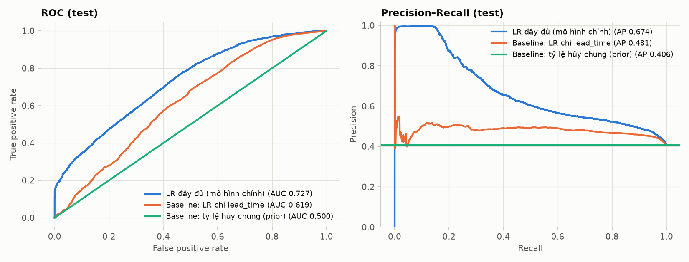
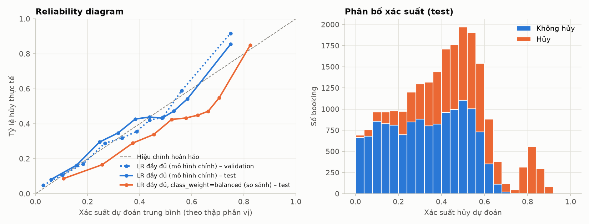
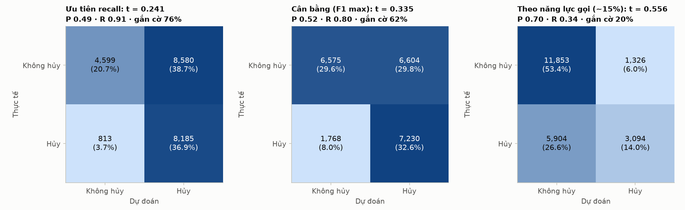
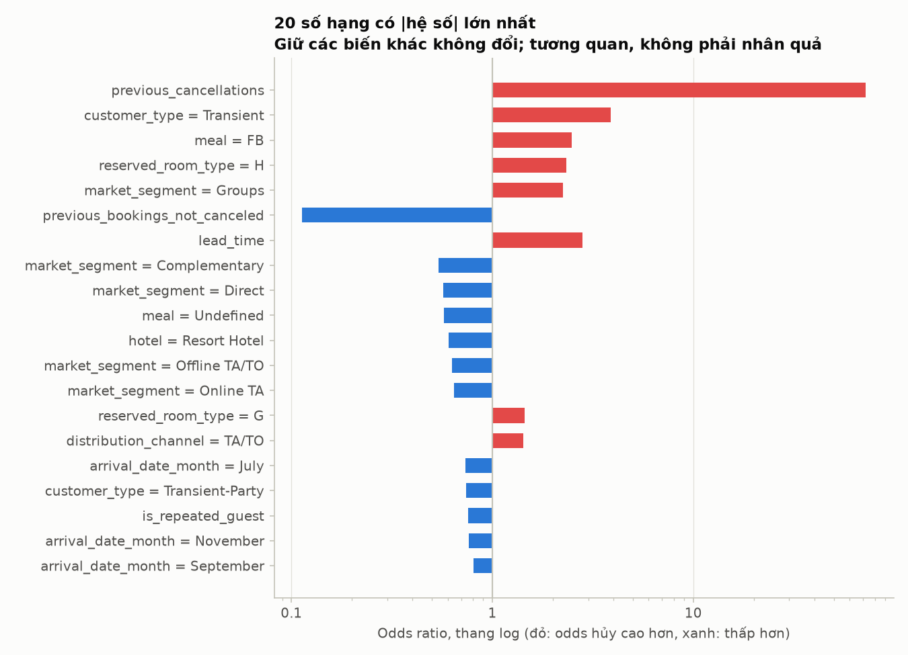
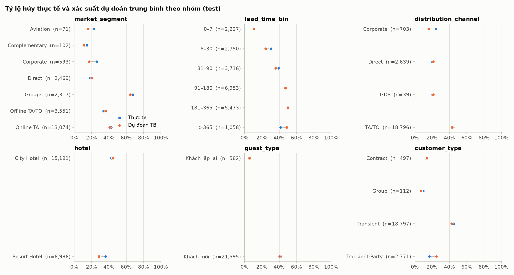
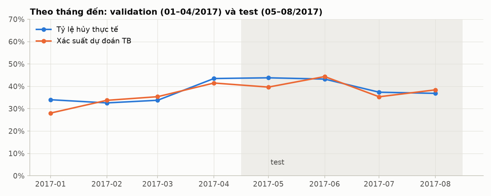

# Kết quả đánh giá (test)

> Sinh tự động bởi `python -m src.evaluate` lúc 2026-10-11T14:36:27+00:00.
> Mô hình: `logreg-1.0-5638e346` (chọn trên validation: G03, {'C': 1, 'l1_ratio': 0.0, 'penalty': 'l2', 'class_weight': None, 'solver': 'lbfgs', 'max_iter': 5000}).
> Tập test: 22,177 booking, tỷ lệ hủy 40.6%. Khoảng tin cậy 95%: bootstrap theo cụm ngày đến, 200 lần.

## 1. Baseline và mô hình đầy đủ (cùng split, cùng đơn vị booking)

| Mô hình | Tập | roc_auc | pr_auc | log_loss | brier | ROC-AUC CI95 | PR-AUC CI95 | Log loss CI95 |
| --- | --- | --- | --- | --- | --- | --- | --- | --- |
| LR đầy đủ (mô hình chính) | validation | 0.7834 | 0.7112 | 0.5269 | 0.1765 | 0.757–0.812 | 0.656–0.766 | 0.511–0.542 |
| LR đầy đủ (mô hình chính) | test | 0.7274 | 0.6742 | 0.5827 | 0.2003 | 0.709–0.748 | 0.638–0.718 | 0.571–0.594 |
| Baseline: tỷ lệ hủy chung (prior) | validation | 0.5000 | 0.3652 | 0.6564 | 0.2318 | 0.500–0.500 | 0.339–0.391 | 0.642–0.671 |
| Baseline: tỷ lệ hủy chung (prior) | test | 0.5000 | 0.4057 | 0.6793 | 0.2430 | 0.500–0.500 | 0.389–0.425 | 0.670–0.690 |
| Baseline: LR chỉ lead_time | validation | 0.6952 | 0.5503 | 0.6175 | 0.2151 | 0.676–0.715 | 0.515–0.582 | 0.596–0.638 |
| Baseline: LR chỉ lead_time | test | 0.6194 | 0.4810 | 0.6795 | 0.2416 | 0.603–0.634 | 0.454–0.513 | 0.666–0.695 |
| LR đầy đủ, class_weight=balanced (so sánh) | validation | 0.7835 | 0.7088 | 0.5520 | 0.1887 | 0.757–0.812 | 0.655–0.764 | 0.532–0.571 |
| LR đầy đủ, class_weight=balanced (so sánh) | test | 0.7274 | 0.6729 | 0.6106 | 0.2142 | 0.710–0.749 | 0.635–0.717 | 0.596–0.623 |

## 2. Calibration

- Log loss 0.5827, Brier 0.2003.
- Xác suất dự đoán trung bình 0.395 so với tỷ lệ hủy thực tế 0.406
  (calibration-in-the-large lệch -0.010).
- Mô hình `class_weight` còn lại: log loss 0.6106, Brier 0.2142.

## 3. Ba ngưỡng hành động (chọn trên validation, áp dụng nguyên trạng cho test)

Trên validation (dùng để chọn):

| Ngưỡng hành động | Ngưỡng | Precision | Recall | Tỷ lệ gắn cờ |
| --- | --- | --- | --- | --- |
| Ưu tiên recall | 0.241 | 0.480 | 0.900 | 0.685 |
| Cân bằng (F1 max) | 0.335 | 0.529 | 0.793 | 0.548 |
| Theo năng lực gọi (~15%) | 0.556 | 0.808 | 0.332 | 0.150 |

Trên test:

| Ngưỡng hành động | Ngưỡng | Precision | Recall | F1 | Tỷ lệ gắn cờ | TP | FP | FN | TN |
| --- | --- | --- | --- | --- | --- | --- | --- | --- | --- |
| Ưu tiên recall | 0.241 | 0.488 | 0.910 | 0.635 | 0.756 | 8,185 | 8,580 | 813 | 4,599 |
| Cân bằng (F1 max) | 0.335 | 0.523 | 0.804 | 0.633 | 0.624 | 7,230 | 6,604 | 1,768 | 6,575 |
| Theo năng lực gọi (~15%) | 0.556 | 0.700 | 0.344 | 0.461 | 0.199 | 3,094 | 1,326 | 5,904 | 11,853 |

## 4. Hệ số và odds ratio (có điều kiện, không suy diễn nhân quả)

Odds ratio của biến số là cho thay đổi từ phân vị 25 → 75 của train (hoặc trung vị → trung vị + 1 nếu hai
phân vị bằng nhau), đã tính qua biến đổi log1p + chuẩn hóa. Biến phân loại so với hạng mục tham chiếu.

| Đặc trưng | Số hạng | So sánh | Hệ số (log-odds) | Odds ratio |
| --- | --- | --- | --- | --- |
| previous_cancellations | previous_cancellations | 0 → 1 (log1p, chuẩn hóa) | 1.468 | 71.943 |
| customer_type | customer_type = Transient | so với customer_type = Contract | 1.359 | 3.891 |
| meal | meal = FB | so với meal = BB | 0.907 | 2.477 |
| reserved_room_type | reserved_room_type = H | so với reserved_room_type = A | 0.848 | 2.336 |
| market_segment | market_segment = Groups | so với market_segment = Aviation | 0.812 | 2.252 |
| previous_bookings_not_canceled | previous_bookings_not_canceled | 0 → 1 (log1p, chuẩn hóa) | -0.774 | 0.113 |
| lead_time | lead_time | 16 → 158 (log1p, chuẩn hóa) | 0.753 | 2.800 |
| market_segment | market_segment = Complementary | so với market_segment = Aviation | -0.617 | 0.539 |
| market_segment | market_segment = Direct | so với market_segment = Aviation | -0.560 | 0.571 |
| meal | meal = Undefined | so với meal = BB | -0.554 | 0.575 |
| hotel | hotel = Resort Hotel | so với hotel = City Hotel | -0.503 | 0.605 |
| market_segment | market_segment = Offline TA/TO | so với market_segment = Aviation | -0.459 | 0.632 |
| market_segment | market_segment = Online TA | so với market_segment = Aviation | -0.441 | 0.643 |
| reserved_room_type | reserved_room_type = G | so với reserved_room_type = A | 0.371 | 1.449 |
| distribution_channel | distribution_channel = TA/TO | so với distribution_channel = Corporate | 0.357 | 1.428 |
| arrival_date_month | arrival_date_month = July | so với arrival_date_month = April | -0.310 | 0.733 |
| customer_type | customer_type = Transient-Party | so với customer_type = Contract | -0.300 | 0.741 |
| is_repeated_guest | is_repeated_guest | 1 so với 0 (khách lặp lại so với khách mới) | -0.280 | 0.756 |
| arrival_date_month | arrival_date_month = November | so với arrival_date_month = April | -0.266 | 0.766 |
| arrival_date_month | arrival_date_month = September | so với arrival_date_month = April | -0.216 | 0.806 |
| arrival_date_month | arrival_date_month = January | so với arrival_date_month = April | -0.207 | 0.813 |
| arrival_date_month | arrival_date_month = May | so với arrival_date_month = April | -0.202 | 0.817 |
| distribution_channel | distribution_channel = Direct | so với distribution_channel = Corporate | -0.176 | 0.838 |
| distribution_channel | distribution_channel = GDS | so với distribution_channel = Corporate | -0.143 | 0.867 |
| reserved_room_type | reserved_room_type = C | so với reserved_room_type = A | 0.138 | 1.148 |
| reserved_room_type | reserved_room_type = D | so với reserved_room_type = A | -0.130 | 0.878 |
| arrival_date_month | arrival_date_month = February | so với arrival_date_month = April | 0.114 | 1.121 |
| reserved_room_type | reserved_room_type = B | so với reserved_room_type = A | -0.112 | 0.894 |
| arrival_date_month | arrival_date_month = March | so với arrival_date_month = April | -0.100 | 0.905 |
| customer_type | customer_type = Group | so với customer_type = Contract | 0.088 | 1.092 |
| arrival_date_month | arrival_date_month = October | so với arrival_date_month = April | -0.088 | 0.916 |
| arrival_date_month | arrival_date_month = August | so với arrival_date_month = April | -0.071 | 0.932 |
| stays_in_weekend_nights | stays_in_weekend_nights | 0 → 2 (log1p, chuẩn hóa) | -0.071 | 0.856 |
| reserved_room_type | reserved_room_type = nhóm hiếm (<50 dòng train) | so với reserved_room_type = A | 0.069 | 1.072 |
| adults | adults | 2 → 3 (log1p, chuẩn hóa) | -0.065 | 0.905 |
| arrival_date_month | arrival_date_month = June | so với arrival_date_month = April | 0.053 | 1.055 |
| market_segment | market_segment = Corporate | so với market_segment = Aviation | -0.053 | 0.949 |
| arrival_date_month | arrival_date_month = December | so với arrival_date_month = April | -0.046 | 0.955 |
| meal | meal = SC | so với meal = BB | 0.045 | 1.046 |
| reserved_room_type | reserved_room_type = E | so với reserved_room_type = A | 0.039 | 1.040 |
| babies | babies | 0 → 1 (log1p, chuẩn hóa) | -0.033 | 0.703 |
| stays_in_week_nights | stays_in_week_nights | 1 → 3 (log1p, chuẩn hóa) | -0.022 | 0.969 |
| reserved_room_type | reserved_room_type = F | so với reserved_room_type = A | 0.021 | 1.022 |
| meal | meal = HB | so với meal = BB | 0.012 | 1.012 |
| distribution_channel | distribution_channel = nhóm hiếm (<50 dòng train) | so với distribution_channel = Corporate | -0.011 | 0.989 |
| children | children | 0 → 1 (log1p, chuẩn hóa) | 0.007 | 1.022 |

## 5. Phân tích lỗi

### 5.1 Theo nhóm (ngưỡng cân bằng F1 = 0.335)

| Biến | Nhóm | n | Tỷ lệ hủy thực tế | Xác suất dự đoán TB | ROC-AUC | Log loss | Precision@F1 | Recall@F1 | Tỷ lệ gắn cờ |
| --- | --- | --- | --- | --- | --- | --- | --- | --- | --- |
| hotel | City Hotel | 15,191 | 0.426 | 0.446 | 0.739 | 0.582 | 0.518 | 0.873 | 0.718 |
| hotel | Resort Hotel | 6,986 | 0.362 | 0.285 | 0.733 | 0.583 | 0.540 | 0.626 | 0.420 |
| distribution_channel | Corporate | 703 | 0.245 | 0.159 | 0.757 | 0.519 | 0.511 | 0.267 | 0.128 |
| distribution_channel | Direct | 2,639 | 0.203 | 0.213 | 0.644 | 0.492 | 0.291 | 0.297 | 0.207 |
| distribution_channel | GDS | 39 | 0.205 | 0.213 | 0.877 | 0.390 | 0.714 | 0.625 | 0.179 |
| distribution_channel | TA/TO | 18,796 | 0.441 | 0.430 | 0.711 | 0.598 | 0.532 | 0.848 | 0.702 |
| market_segment | Aviation | 71 | 0.225 | 0.160 | 0.635 | 0.528 | 1.000 | 0.188 | 0.042 |
| market_segment | Complementary | 102 | 0.147 | 0.113 | 0.481 | 0.540 | 0.000 | 0.000 | 0.029 |
| market_segment | Corporate | 593 | 0.258 | 0.173 | 0.799 | 0.484 | 0.505 | 0.301 | 0.153 |
| market_segment | Direct | 2,469 | 0.187 | 0.205 | 0.623 | 0.484 | 0.242 | 0.258 | 0.199 |
| market_segment | Groups | 2,317 | 0.677 | 0.645 | 0.901 | 0.415 | 0.742 | 0.928 | 0.846 |
| market_segment | Offline TA/TO | 3,551 | 0.340 | 0.362 | 0.766 | 0.548 | 0.487 | 0.767 | 0.535 |
| market_segment | Online TA | 13,074 | 0.427 | 0.410 | 0.632 | 0.646 | 0.499 | 0.839 | 0.718 |
| customer_type | Contract | 497 | 0.129 | 0.139 | 0.646 | 0.370 | 0.000 | 0.000 | 0.002 |
| customer_type | Group | 112 | 0.098 | 0.070 | 0.685 | 0.319 | 0.000 | 0.000 | 0.009 |
| customer_type | Transient | 18,797 | 0.450 | 0.426 | 0.713 | 0.602 | 0.538 | 0.842 | 0.704 |
| customer_type | Transient-Party | 2,771 | 0.167 | 0.249 | 0.582 | 0.497 | 0.179 | 0.231 | 0.216 |
| lead_time_bin | 0–7 | 2,227 | 0.111 | 0.108 | 0.640 | 0.342 | 0.886 | 0.126 | 0.016 |
| lead_time_bin | 8–30 | 2,750 | 0.305 | 0.244 | 0.598 | 0.609 | 0.353 | 0.208 | 0.180 |
| lead_time_bin | 31–90 | 3,716 | 0.394 | 0.359 | 0.573 | 0.658 | 0.438 | 0.709 | 0.638 |
| lead_time_bin | 91–180 | 6,953 | 0.470 | 0.471 | 0.717 | 0.596 | 0.534 | 0.942 | 0.830 |
| lead_time_bin | 181–365 | 5,473 | 0.500 | 0.500 | 0.705 | 0.610 | 0.561 | 0.939 | 0.837 |
| lead_time_bin | >365 | 1,058 | 0.415 | 0.486 | 0.792 | 0.528 | 0.580 | 0.768 | 0.549 |
| guest_type | Khách lặp lại | 582 | 0.064 | 0.058 | 0.751 | 0.216 | 0.517 | 0.405 | 0.050 |
| guest_type | Khách mới | 21,595 | 0.415 | 0.404 | 0.718 | 0.593 | 0.523 | 0.805 | 0.639 |

### 5.2 Theo tháng đến

| Biến | Nhóm | n | Tỷ lệ hủy thực tế | Xác suất dự đoán TB | ROC-AUC | Log loss | Precision@F1 | Recall@F1 | Tỷ lệ gắn cờ |
| --- | --- | --- | --- | --- | --- | --- | --- | --- | --- |
| arrival_month | 2017-05 | 6,305 | 0.438 | 0.397 | 0.782 | 0.547 | 0.588 | 0.801 | 0.596 |
| arrival_month | 2017-06 | 5,639 | 0.432 | 0.444 | 0.756 | 0.571 | 0.537 | 0.879 | 0.707 |
| arrival_month | 2017-07 | 5,310 | 0.374 | 0.353 | 0.675 | 0.610 | 0.475 | 0.719 | 0.566 |
| arrival_month | 2017-08 | 4,923 | 0.368 | 0.384 | 0.666 | 0.613 | 0.470 | 0.799 | 0.627 |

### 5.3 Cơ cấu lỗi theo market_segment (tỷ lệ trong từng loại kết quả)

| market_segment | FN | FP | đúng |
| --- | --- | --- | --- |
| Aviation | 0.007 | 0.000 | 0.004 |
| Complementary | 0.008 | 0.000 | 0.006 |
| Corporate | 0.061 | 0.007 | 0.032 |
| Direct | 0.194 | 0.056 | 0.127 |
| Groups | 0.064 | 0.076 | 0.123 |
| Offline TA/TO | 0.159 | 0.147 | 0.166 |
| Online TA | 0.507 | 0.712 | 0.541 |

Cơ cấu theo `deposit_type` (biến KHÔNG có trong mô hình, chỉ dùng để giải thích lỗi):

| deposit_type | FN | FP | đúng |
| --- | --- | --- | --- |
| No Deposit | 0.985 | 1.000 | 0.854 |
| Non Refund | 0.008 | 0.000 | 0.146 |
| Refundable | 0.007 | 0.000 | 0.001 |

### 5.4 FP/FN điển hình (tin chắc nhất mà sai)

| loai | probability | is_canceled | hotel | lead_time | market_segment | distribution_channel | customer_type | deposit_type | previous_cancellations | is_repeated_guest | adults | stays_in_week_nights | arrival_date |
| --- | --- | --- | --- | --- | --- | --- | --- | --- | --- | --- | --- | --- | --- |
| FP (dự đoán hủy, thực tế không) | 0.983 | 0 | Resort Hotel | 80 | Direct | Direct | Transient | No Deposit | 1 | 0 | 2 | 2 | 2017-06-09 |
| FP (dự đoán hủy, thực tế không) | 0.845 | 0 | City Hotel | 208 | Groups | TA/TO | Transient | No Deposit | 0 | 0 | 1 | 3 | 2017-05-24 |
| FP (dự đoán hủy, thực tế không) | 0.797 | 0 | City Hotel | 174 | Groups | TA/TO | Transient | No Deposit | 0 | 0 | 2 | 3 | 2017-07-19 |
| FP (dự đoán hủy, thực tế không) | 0.796 | 0 | Resort Hotel | 178 | Online TA | TA/TO | Transient | No Deposit | 0 | 0 | 3 | 5 | 2017-08-27 |
| FP (dự đoán hủy, thực tế không) | 0.773 | 0 | City Hotel | 12 | Corporate | Corporate | Transient | No Deposit | 1 | 1 | 1 | 2 | 2017-06-05 |
| FN (dự đoán không, thực tế hủy) | 0.000 | 1 | City Hotel | 1 | Corporate | Corporate | Transient | No Deposit | 0 | 1 | 1 | 2 | 2017-07-18 |
| FN (dự đoán không, thực tế hủy) | 0.001 | 1 | Resort Hotel | 1 | Direct | Direct | Transient | No Deposit | 0 | 1 | 1 | 1 | 2017-05-05 |
| FN (dự đoán không, thực tế hủy) | 0.002 | 1 | Resort Hotel | 0 | Direct | Direct | Transient | No Deposit | 0 | 1 | 1 | 1 | 2017-08-24 |
| FN (dự đoán không, thực tế hủy) | 0.002 | 1 | City Hotel | 4 | Corporate | Corporate | Transient | No Deposit | 0 | 1 | 1 | 0 | 2017-06-05 |
| FN (dự đoán không, thực tế hủy) | 0.002 | 1 | City Hotel | 4 | Complementary | Corporate | Transient | No Deposit | 0 | 1 | 1 | 0 | 2017-08-28 |

### 5.5 Ngoài miền

| Nhóm | n | Tỷ lệ hủy thực tế | Xác suất dự đoán TB |
| --- | --- | --- | --- |
| Trong miền train | 22,166 | 0.406 | 0.396 |
| Ngoài miền số (ngoài [min, max] của train) | 11 | 0.000 | 0.066 |
| Hạng mục hiếm/chưa gặp (< 50 dòng train) | 0 | nan | nan |

Thử nghiệm ngoại suy `lead_time` cho một booking điển hình (City, Online TA, tháng 8, 2 người lớn, 3 đêm):

| lead_time | probability | trong_mien |
| --- | --- | --- |
| 0 | 0.108 | có |
| 30 | 0.371 | có |
| 100 | 0.504 | có |
| 365 | 0.648 | có |
| 629 | 0.702 | có |
| 1,000 | 0.745 | không |
| 2,000 | 0.801 | không |
